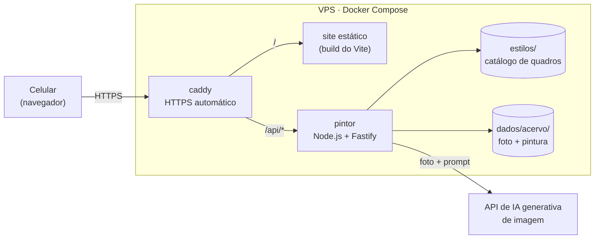

# camera-ai

Projeto de estudo de **IA generativa de imagens**: um site aberto por QR code em que a pessoa tira uma foto com o celular e recebe essa foto repintada no estilo de um quadro de Van Gogh.

> **Status:** em planejamento. A [especificação](docs/superpowers/specs/2026-10-27-experiencia-van-gogh-qrcode-design.md) e o [plano de implementação](docs/superpowers/plans/2026-10-27-experiencia-van-gogh-qrcode.md) estão prontos; o código será construído seguindo o plano. Os comandos abaixo descrevem como o projeto vai funcionar quando as etapas estiverem concluídas.

## A ideia

O projeto é um exercício prático para aprender a usar IA generativa num produto real, de ponta a ponta:

- **Imagem para imagem:** enviar uma foto e um prompt a um modelo de edição de imagem e receber a mesma cena em outro estilo, com o rosto ainda reconhecível.
- **Prompt de estilo:** cada quadro tem seu próprio prompt e, opcionalmente, uma imagem de referência.
- **Comparar provedores:** um adaptador único permite trocar de modelo por variável de ambiente e rodar um teste comparativo lado a lado (qualidade, tempo e custo).
- **Operar IA com custo sob controle:** fila de chamadas, limites por aparelho e por IP, teto diário e um interruptor para ligar e desligar a experiência.
- **Entregar no celular sem app:** site estático, câmera nativa do aparelho e compartilhamento pelo menu do próprio celular.

O cenário de uso é um estande de evento: um QR code impresso leva ao site e cada visitante sai com uma "pintura" sua para compartilhar.

## Como funciona

### Fluxo no celular

1. A pessoa lê o QR code e abre o site, sem instalar nada.
2. Escolhe um quadro: Noite Estrelada, Girassóis, Terraço do Café à Noite ou Autorretrato (1889).
3. Toca em **Tirar foto**, que abre a câmera nativa do celular.
4. O site corrige a rotação, reduz a foto para no máximo 1600 px e envia um JPEG de cerca de 300 a 500 KB.
5. Enquanto a IA trabalha (5 a 20 s), uma animação de pinceladas "pinta" a foto na tela.
6. A pintura aparece com ou sem uma moldura dourada, desenhada no próprio celular, pronta para **compartilhar** ou **salvar**.

### Arquitetura



| Parte | Tecnologia | Papel |
|---|---|---|
| `site/` | Vite + TypeScript, sem framework | Telas, preparo da foto, chamada à API, moldura, compartilhar e salvar |
| `servidor/` (serviço "pintor") | Node.js 22, Fastify, `sharp` | Valida a foto, aplica as proteções, chama a IA e grava o acervo |
| `estilos/` | Pastas com JSON e imagens | Catálogo de quadros, separado do código |
| `deploy/` | Docker Compose + Caddy | HTTPS, arquivos do site e proxy para a API |

A chave da API de IA fica só no servidor, em variável de ambiente; o site nunca a recebe.

### API do pintor

| Método | Rota | Função |
|---|---|---|
| `GET` | `/api/estilos` | Lista os quadros ativos, em ordem |
| `GET` | `/api/estilos/:id/miniatura` | Miniatura de um quadro |
| `POST` | `/api/pintar` | Recebe a foto e devolve a pintura (`image/jpeg`) com o cabeçalho `X-Codigo-Obra` |
| `GET` | `/api/saude` | Estado do serviço: evento ativo, pinturas do dia, teto e tamanho da fila |

O caminho de um pedido em `POST /api/pintar`:

```
foto ─▶ evento ativo? ─▶ pedido válido? (quadro existe, foto ≤ 5 MB, reencode sem metadados)
     ─▶ limite por aparelho e por IP ─▶ teto diário ─▶ fila (5 chamadas simultâneas)
     ─▶ provedor de IA (1 nova tentativa em falha temporária, até 90 s no total)
     ─▶ grava no acervo ─▶ responde a pintura + código da obra
```

Quando algo falha, a resposta é um JSON `{ erro, mensagem }` com uma mensagem amigável que o site mostra, junto com um botão **Tentar de novo** que reenvia a mesma foto.

### Módulo de estilos

Cada quadro é uma pasta em `estilos/`; o nome da pasta é o `id` do estilo.

```
estilos/
  noite-estrelada/
    estilo.json
    miniatura.jpg
    referencia.jpg      (opcional, enviada ao modelo como referência de estilo)
```

```json
{
  "nome": "Noite Estrelada",
  "artista": "Vincent van Gogh",
  "prompt": "Repaint this photo as a Vincent van Gogh oil painting in the style of The Starry Night (1889)...",
  "ordem": 1,
  "ativo": true
}
```

- Para incluir um quadro: copie uma pasta, edite o `estilo.json`, gere as imagens com `npx tsx scripts/preparar-estilo.ts <imagem-do-quadro> <pasta-do-estilo>` (dentro de `servidor/`) e reinicie o pintor.
- `"ativo": false` esconde o quadro sem apagá-lo.
- Uma pasta inválida é ignorada com um aviso no log; o serviço continua de pé.
- Os prompts ficam em inglês, que os modelos de imagem seguem melhor.

### Provedores de IA

Todos os provedores implementam a mesma interface, `pintar(foto, estilo): Promise<Buffer>`, e o ativo é escolhido pela variável `PROVEDOR`.

- **`falso`** existe sempre: devolve a própria foto com um filtro, sem custo. Serve para desenvolvimento e testes.
- O prompt enviado junta o prompt do quadro com uma instrução fixa para preservar rosto, pose e composição da foto.
- Candidatos em avaliação no teste comparativo: Nano Banana 2.1 (Google), Seedream 5.0, FLUX.2 pro (via fal.ai) e, opcionalmente, GPT Image 2.5. Depois da escolha, ficam no código só o provedor escolhido e o `falso`.

### Acervo

Cada pintura bem-sucedida é gravada em `dados/acervo/AAAA-MM-DD/<código>/` com `original.jpg`, `pintura.jpg` e `info.json` (quadro, provedor, modelo e data). O código da obra tem o formato `XXX-XXX`, sem caracteres ambíguos. A pasta `dados/` não é servida por HTTP nem versionada.

## Estrutura do repositório

```
site/        frontend (Vite + TypeScript)
servidor/    serviço "pintor" (Node.js + Fastify)
estilos/     catálogo de quadros (dados, não código)
deploy/      docker-compose.yml, Caddyfile, Dockerfiles, .env.exemplo
scripts/     backup do acervo e geração do QR code
docs/        especificação, plano de implementação e checklists
```

## Desenvolvimento local

Pré-requisito: Node.js 22 LTS. Com o provedor `falso` não é preciso nenhuma chave de API.

Instale as dependências:

```bash
npm --prefix servidor install
```

```bash
npm --prefix site install
```

Suba o pintor em `http://localhost:3000`:

```bash
PROVEDOR=falso EVENTO_ATIVO=true npm --prefix servidor run dev
```

Em outro terminal, suba o site em `http://localhost:5173` (o Vite encaminha `/api` para o pintor):

```bash
npm --prefix site run dev
```

### Testes

| Comando | O que testa |
|---|---|
| `npm --prefix servidor test` | Servidor com Vitest e provedor `falso` |
| `npm --prefix site test` | Preparo da foto e moldura (Vitest no navegador) |
| `npm --prefix site run e2e` | Fluxo completo com Playwright, emulando iPhone e Android |

Antes do primeiro e2e, instale os navegadores do Playwright:

```bash
cd site && npx playwright install chromium webkit
```

## Deploy

O deploy roda numa VPS Linux com Docker Compose e dois serviços:

- **`caddy`** publica as portas 80 e 443, emite o certificado HTTPS (Let's Encrypt), serve o build do site e faz proxy de `/api/*` para o pintor.
- **`pintor`** não publica porta; só o Caddy fala com ele. Monta `estilos/` como somente leitura e `dados/acervo/` com escrita. O Caddy não tem acesso ao acervo.

### Requisitos

- VPS com Docker e o plugin Compose.
- Um subdomínio com registro DNS apontando para o IP da VPS.
- Portas 80 e 443 livres.
- Chave de API do provedor escolhido.

### Passo a passo

1. Clone o repositório na VPS:

   ```bash
   git clone https://github.com/yansalim/camera-ai.git && cd camera-ai
   ```

2. Crie o `.env` a partir do exemplo e preencha:

   ```bash
   cp deploy/.env.exemplo deploy/.env
   ```

3. Crie a pasta do acervo com o dono do usuário do contêiner (`node`, uid 1000):

   ```bash
   mkdir -p dados/acervo && sudo chown 1000:1000 dados/acervo
   ```

4. Construa e suba os serviços:

   ```bash
   docker compose -f deploy/docker-compose.yml up -d --build
   ```

5. Confira se o serviço respondeu `"ok":true`:

   ```bash
   curl https://SEU_SUBDOMINIO/api/saude
   ```

### Variáveis do `deploy/.env`

| Variável | Padrão | Uso |
|---|---|---|
| `DOMINIO` | — | Subdomínio público; o Caddy emite o certificado para ele |
| `PROVEDOR` | `falso` | Provedor de IA ativo |
| Chave do provedor | — | Ex.: `FAL_KEY`, `GEMINI_API_KEY`, `OPENAI_API_KEY`, conforme o provedor escolhido |
| `EVENTO_ATIVO` | `false` | Interruptor: desligado, `/api/pintar` recusa pedidos |
| `LIMITE_APARELHO` / `JANELA_APARELHO_MIN` | `5` / `10` | Pinturas por aparelho na janela, em minutos |
| `LIMITE_IP` / `JANELA_IP_MIN` | `60` / `60` | Pinturas por IP na janela, em minutos |
| `TETO_DIARIO` | `1000` | Máximo de pinturas por dia |
| `CONCORRENCIA` | `5` | Chamadas simultâneas ao provedor |
| `TEMPO_MAXIMO_S` | `90` | Tempo máximo de uma pintura, incluindo fila e nova tentativa |

`PORTA`, `ESTILOS_DIR` e `ACERVO_DIR` já vêm definidos na imagem do pintor.

### Operação

Ligar ou desligar a experiência: altere `EVENTO_ATIVO` no `deploy/.env` e recrie o pintor (`restart` não relê o `.env`):

```bash
docker compose -f deploy/docker-compose.yml up -d pintor
```

Recarregar o catálogo depois de mudar algo em `estilos/`:

```bash
docker compose -f deploy/docker-compose.yml restart pintor
```

Atualizar o código:

```bash
git pull && docker compose -f deploy/docker-compose.yml up -d --build
```

Acompanhar os logs do pintor:

```bash
docker compose -f deploy/docker-compose.yml logs -f pintor
```

Gerar o backup do acervo em `dados/backups/acervo-AAAA-MM-DD.zip`, para baixar depois por `scp`:

```bash
bash scripts/backup-acervo.sh .
```

Gerar o QR code para impressão (`qrcode.svg` e `qrcode.png`, 2000 px):

```bash
npm --prefix scripts install && node scripts/gerar-qrcode.mjs https://SEU_SUBDOMINIO
```

Se a VPS já tiver Nginx ou outro serviço nas portas 80/443, troque o Caddy por um bloco no servidor existente com o mesmo roteamento: `/api/*` para o pintor e o resto para os arquivos de `site/dist`.

## Planejamento

O trabalho está dividido em 15 tarefas, detalhadas no [plano de implementação](docs/superpowers/plans/2026-10-27-experiencia-van-gogh-qrcode.md). As decisões de produto e de arquitetura estão na [especificação](docs/superpowers/specs/2026-10-27-experiencia-van-gogh-qrcode-design.md).

- [ ] 1. Servidor base e módulo de estilos com os 4 quadros
- [ ] 2. Interface de provedor, provedor `falso` e configuração
- [ ] 3. Adaptadores candidatos e teste comparativo de provedores
- [ ] 4. Acervo: código da obra e gravação
- [ ] 5. Proteções: limitador, teto diário e fila
- [ ] 6. Preparo de imagens no servidor
- [ ] 7. App Fastify, erros e rotas de estilos e saúde
- [ ] 8. Rota `POST /api/pintar`
- [ ] 9. Site base, armazenamento local e cliente da API
- [ ] 10. Preparo da foto e moldura no site
- [ ] 11. Telas de início, quadros e foto, com a base dos testes e2e
- [ ] 12. Revelação, resultado, erros e compartilhamento
- [ ] 13. Deploy com Docker Compose e Caddy
- [ ] 14. Operação: backup, QR code e checklist do evento
- [ ] 15. Publicação na VPS e testes em celulares reais

A tarefa 3 precisa de chaves de API e fotos de teste, então pode correr em paralelo às tarefas 4 a 12, que usam o provedor `falso`.
